<p align="center"></p>

# Drzemka · Power Nap Studio

**Android · Kotlin · Jetpack Compose · Polski / English · Offline**

[Polski](#polski) · [English](#english) · [Architektura / Architecture](docs/ANDROID-ARCHITECTURE.md) · [Prywatność / Privacy](docs/PRIVACY.md)

## Polski

Krótki odpoczynek zamiast kolejnych minut scrollowania. Drzemka łączy spokojne pejzaże dźwiękowe, minutnik i zdecydowaną pobudkę dla śpiochów. Opcjonalnie proponuje przerwę po długim przewijaniu w wybranych aplikacjach telefonu.

**Status:** działająca wersja rozwojowa Androida w `android/`. Projekt React/TanStack w `src/` pozostaje pierwotną makietą Lovable. Nie jest mobilną warstwą wykonawczą i nie obserwuje innych aplikacji.

### Funkcje

- Drzemki 10, 15, 20 i 30 minut, pauza, wznowienie i zakończenie.
- 12 autorskich, syntetycznych scen offline: samolot, pociąg, łąka, las, deszcz, burza, morze, sztorm, kominek, wiatr, szum biały i brązowy. To dźwięki proceduralne, nie nagrania terenowe.
- Łagodne narastanie tła, płynna zmiana sceny i wyciszenie przed pobudką.
- Profile **Łagodny** i **Dla śpiochów**: mocny powtarzany alarm z wibracją, osobna głośność pobudki i test trwający 5 sekund.
- Alarm do potwierdzenia lub przez maksymalnie 10 minut. Jedna dodatkowa drzemka na 2 minuty. Otwarcie powiadomienia nie zatrzymuje alarmu.
- Natywne audio w tle, dokładny alarm i sterowanie z powiadomienia.
- Opcjonalne sugestie odpoczynku po 10/20/30 aktywnych minutach przewijania w wybranych aplikacjach. Godzinny limit, odroczenie i opcjonalne godziny ciszy 22:00–08:00.
- Pełne PL/EN: interfejs, opisy dźwięków, zgody, komunikaty i powiadomienia. Język systemowy lub wybór ręczny.
- Lokalny zapis ustawień. Bez konta, reklam, analityki i uprawnienia do internetu.

### Zrzuty ekranu: wersja polska

Rzeczywista aplikacja na emulatorze Pixel 6 z Androidem 15, uchwycona podczas testów interfejsu.

| Odpoczynek | Dźwięki | Ustawienia |
| --- | --- | --- |
| 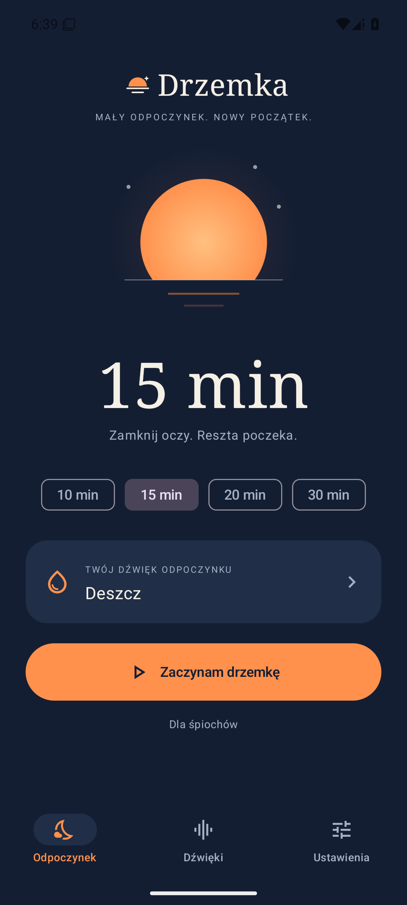 | 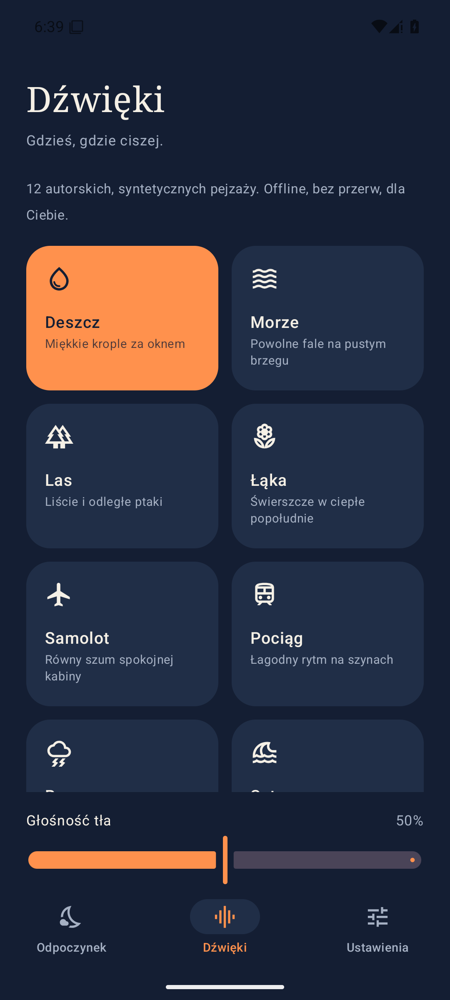 | 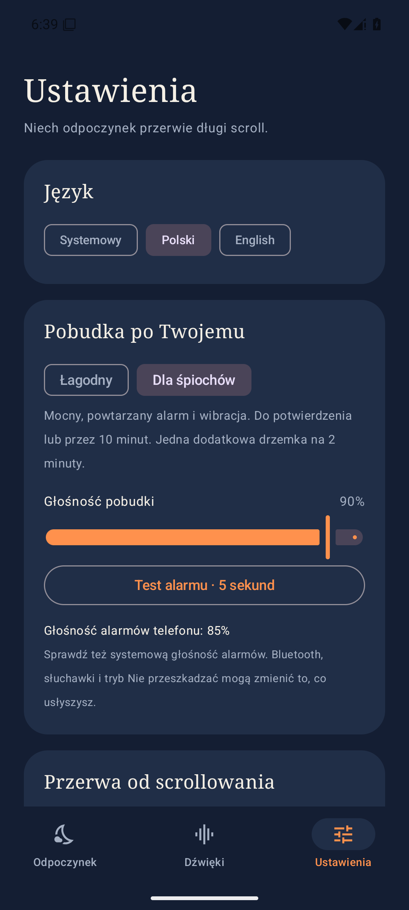 |

| Trwająca drzemka | Pobudka | Propozycja przerwy |
| --- | --- | --- |
| 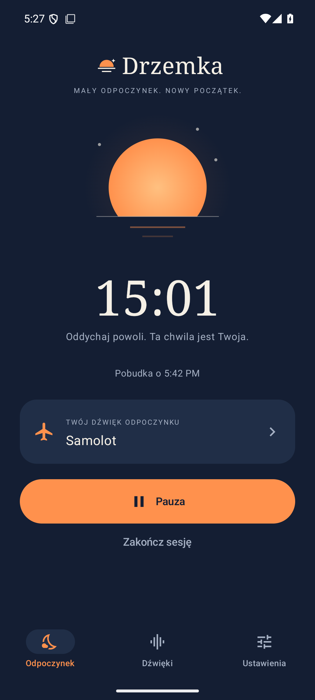 | 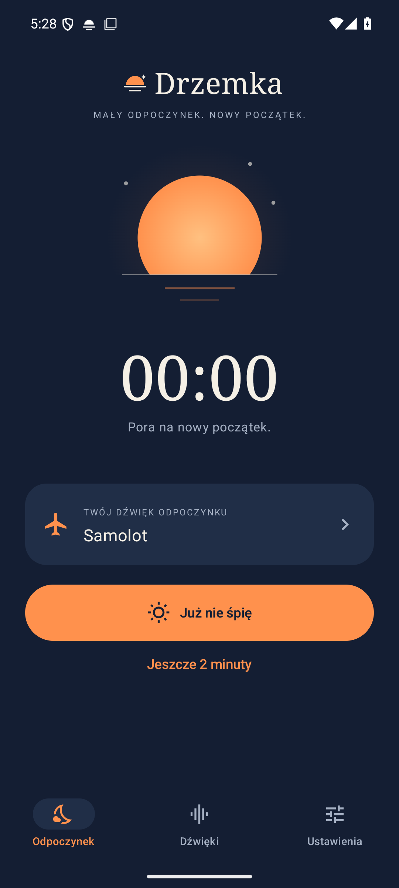 |  |

### Uruchomienie

Wymagania: Android 8.0+, JDK 17 lub 21, Android SDK Platform 36 i Build Tools 35.0.0. Lokalna weryfikacja używa JDK 21. Gradle Wrapper jest dołączony.

```powershell
cd android
.\gradlew.bat :app:assembleDebug
adb install -r app/build/outputs/apk/debug/app-debug.apk
```

Na macOS/Linux użyj `bash gradlew :app:assembleDebug`. Ustaw `ANDROID_HOME` na katalog SDK albo dodaj lokalny `android/local.properties` z `sdk.dir=...`. Ten plik jest wyłączony z Git.

APK: `android/app/build/outputs/apk/debug/app-debug.apk`. To pakiet deweloperski podpisany kluczem debug, nie wydanie sklepowe.

1. W ustawieniach aplikacji zezwól na powiadomienia i dokładne alarmy.
2. Wybierz profil pobudki, sprawdź systemową głośność alarmów i uruchom test.
3. Wybierz tło, czas i rozpocznij drzemkę.
4. Opcjonalnie wybierz obserwowane aplikacje, włącz sugestie odpoczynku, przeczytaj objaśnienie i włącz usługę Drzemka w ustawieniach dostępności Androida.

### Obserwacja i ograniczenia

Accessibility wykorzystuje typ zdarzenia, identyfikator aplikacji i czas. Nie czyta tekstu ekranu, wpisywanych treści ani zrzutów. Nie wszystkie aplikacje udostępniają zdarzenia przewijania. Bez tej zgody nadal działają drzemki, ale nie działa obserwacja. Aplikacja nie diagnozuje zmęczenia.

„Za godzinę” wycisza sugestie przez godzinę, a „Nie dzisiaj” do północy. Kliknięcie propozycji przygotowuje 15-minutową drzemkę, bez automatycznego rozpoczęcia.

Głośność systemowa, Nie przeszkadzać, słuchawki, Bluetooth i ograniczenia baterii producenta wpływają na alarm. Wyłączenie telefonu, restart lub wymuszone zatrzymanie aplikacji uniemożliwiają niezawodną pobudkę. Sprawdź działanie na swoim telefonie. Testy emulatora nie zastępują odsłuchu i weryfikacji fizycznego urządzenia.

Publikacja w Google Play nie została wykonana. Wymaga podpisania wydania, deklaracji Accessibility i foreground service, danych kontaktowych w polityce prywatności oraz oceny sklepu.

### Weryfikacja

```powershell
python tools/check-locales.py
cd android
.\gradlew.bat :app:assembleDebug :app:testDebugUnitTest :app:lintDebug
```

Testy urządzenia i odtworzenie zrzutów opisuje [raport weryfikacji](docs/VERIFICATION.md). Workflow GitHub Actions buduje debug APK, uruchamia testy i Lint oraz udostępnia APK jako artefakt po uruchomieniu workflow.

## English

A little rest instead of another long scroll. Drzemka combines calming soundscapes, a nap timer and a strong wake-up option for heavy sleepers. Optional reminders suggest a break after sustained scrolling in selected Android apps.

**Status:** functional Android development build in `android/`. The React/TanStack project in `src/` remains the original Lovable mockup, not the mobile runtime. It does not monitor other apps.

### Features

- 10, 15, 20 and 30-minute naps, pause, resume and stop.
- 12 original offline synthesized soundscapes: airplane, train, meadow, forest, rain, thunderstorm, sea, ocean storm, fireplace, wind, white noise and brown noise. These are procedural sounds, not field recordings.
- Ambient fade-in, scene crossfades and reduced background volume before waking.
- **Gentle** chime or **Heavy sleeper** mode with strong repeating tones and vibration. Independent wake-up volume and a five-second preview.
- Explicit dismissal, a ten-minute alarm limit and one two-minute snooze. Opening the notification does not dismiss the alarm.
- Native background audio, precise alarm scheduling and notification controls.
- Opt-in scrolling reminders for selected apps: 10/20/30 active-minute thresholds, hourly cooldown, deferral and optional 22:00–08:00 quiet hours.
- Complete Polish and English interface, sound descriptions, disclosures and notifications. System language or manual selection.
- Local preferences. No account, ads, analytics or internet permission.

### Screenshots: English version

Actual app on a Pixel 6 Android 15 emulator, captured by UI tests.

| Rest | Sound library | Settings |
| --- | --- | --- |
| 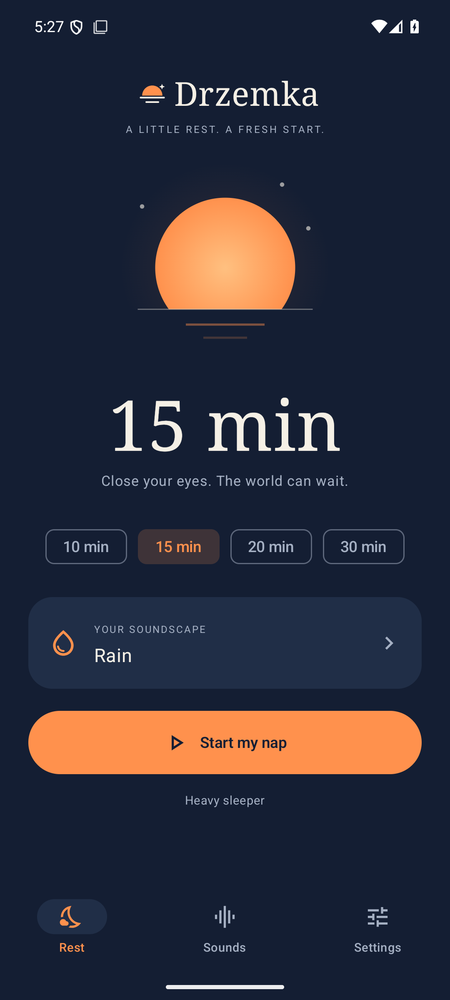 | 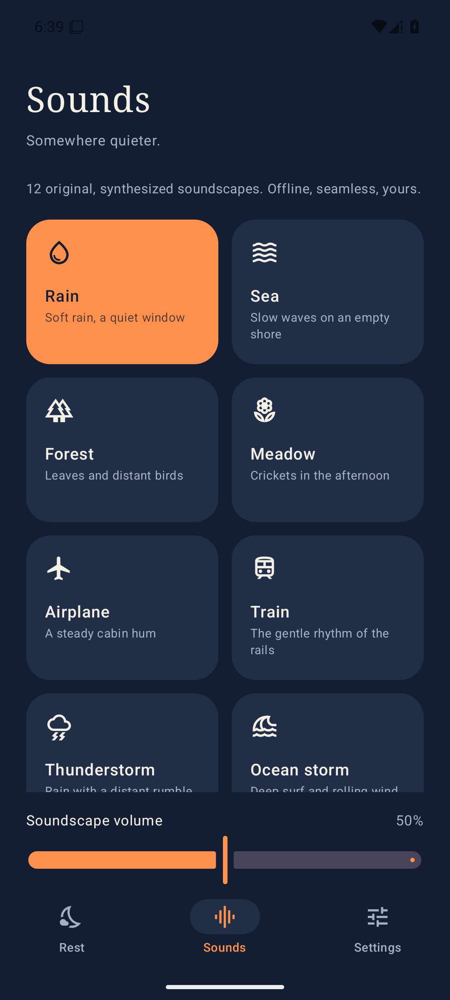 | 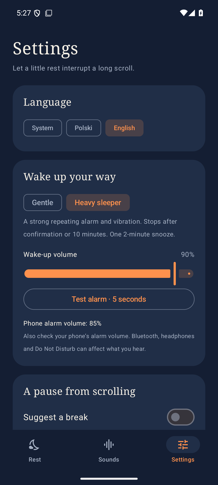 |

| Active nap | Wake-up | Break suggestion |
| --- | --- | --- |
| 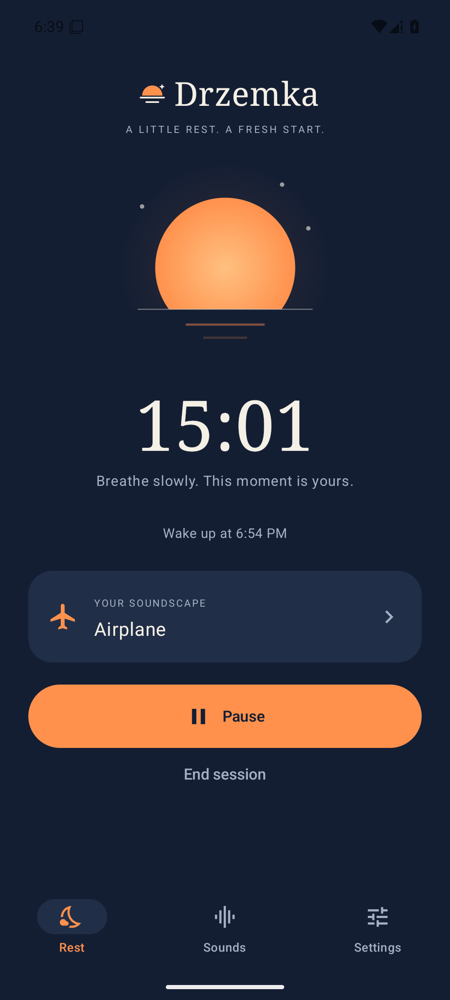 | 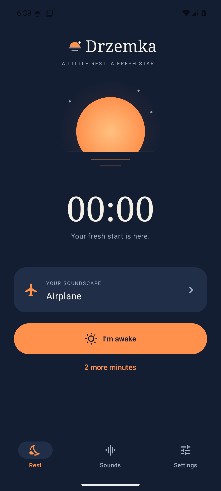 | 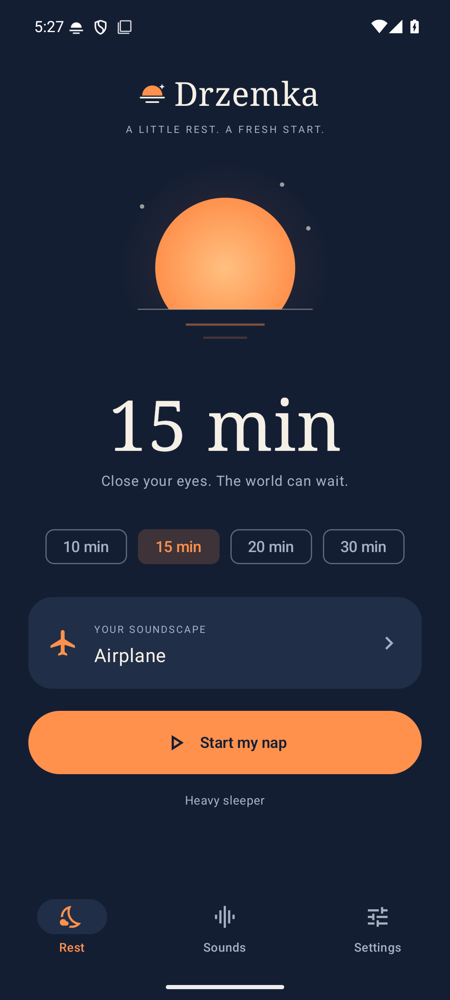 |

### Build and run

Requires Android 8.0+, JDK 17 or 21, Android SDK Platform 36 and Build Tools 35.0.0. Local verification uses JDK 21. The Gradle Wrapper is included.

```sh
cd android
bash gradlew :app:assembleDebug
adb install -r app/build/outputs/apk/debug/app-debug.apk
```

On Windows use `.\gradlew.bat`. Set `ANDROID_HOME` or create an untracked `android/local.properties` containing `sdk.dir=...`.

Output: `android/app/build/outputs/apk/debug/app-debug.apk`. This is a development APK signed with a debug key, not a store release.

Allow notifications and precise alarms in settings, select a wake-up profile and test your phone’s alarm volume. Choose a soundscape and duration, then start. For scrolling suggestions, select apps, opt in after reading the disclosure and enable Drzemka in Android Accessibility settings.

### Observation and limitations

The Accessibility service uses event types, app identifiers and timestamps only. It does not read screen text, typed input or screenshots. Some apps do not emit scrolling events. Without this permission, naps still work but scrolling observation does not. The app does not diagnose fatigue.

“In an hour” mutes suggestions for an hour; “Not today” mutes them until midnight. Opening a suggestion prepares a 15-minute nap without automatically starting it.

System alarm volume, Do Not Disturb, headphones, Bluetooth and manufacturer battery restrictions can affect playback. Powering off, rebooting or force-stopping prevents reliable wake-up. Test on your own phone before relying on it. Emulator checks do not replace listening and physical-device verification.

Google Play publication has not been performed. It requires release signing, Accessibility and foreground-service declarations, publisher contact details in the privacy policy and store review.

### Verification

```sh
python3 tools/check-locales.py
cd android
bash gradlew :app:assembleDebug :app:testDebugUnitTest :app:lintDebug
```

See the [verification report](docs/VERIFICATION.md) for device tests and screenshot reproduction. GitHub Actions builds a debug APK, runs unit tests and Lint, and uploads the APK as a workflow artifact when the workflow runs.

## Repository layout

```text
android/                 Native Android app, tests and Gradle Wrapper
src/                     Original React/TanStack Lovable mockup
public/drzemka-icon.svg   Original vector brand icon
docs/screenshots/pl/     Actual Polish app screenshots
docs/screenshots/en/     Actual English app screenshots
docs/                    Architecture, privacy and verification
tools/check-locales.py   PL/EN resource parity check
```

The web mockup remains connected to [Lovable](https://lovable.dev/projects/365b5513-dcf0-4fd0-ad70-15320c7f7b3d). Its original handoff is in [docs/CODEX.md](docs/CODEX.md). Native decisions are in [docs/ANDROID-ARCHITECTURE.md](docs/ANDROID-ARCHITECTURE.md). Do not rewrite published Git history or manually edit Lovable-managed database migrations.
>>>>>>> 1be2434 (version v0.2)
